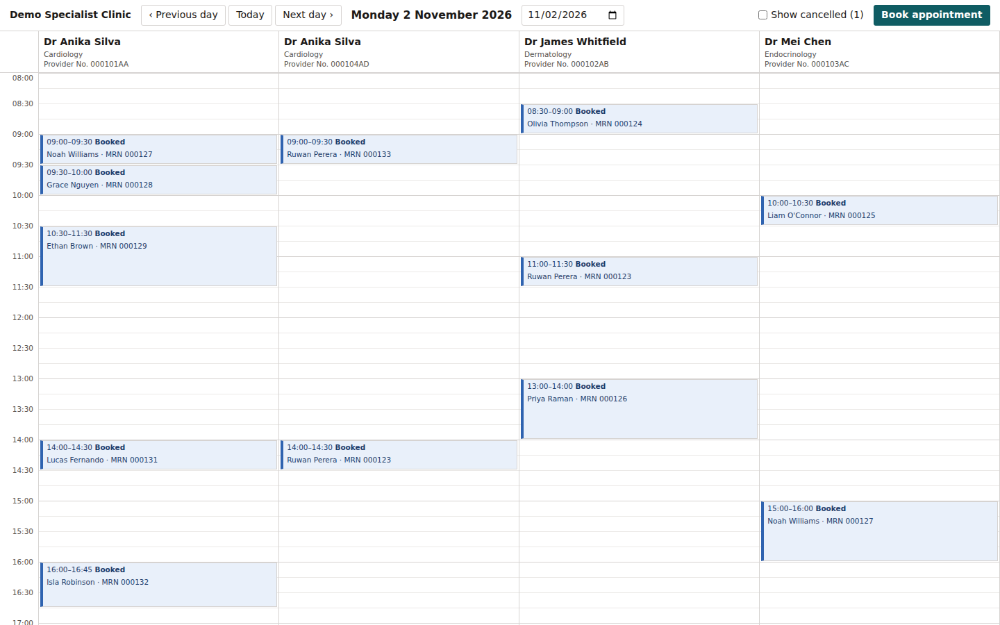
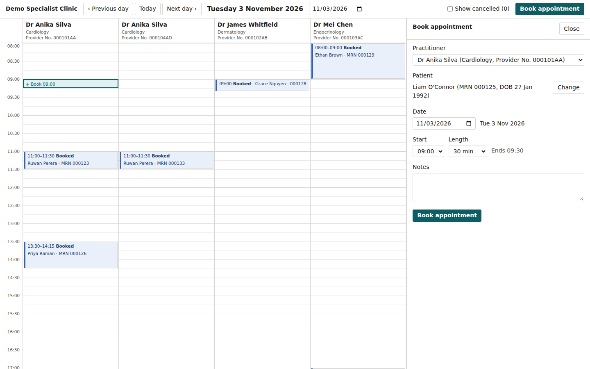
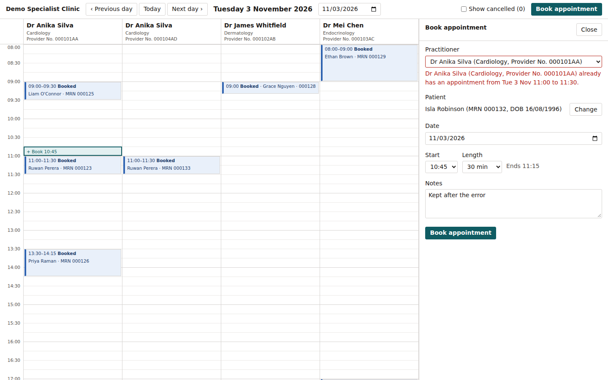
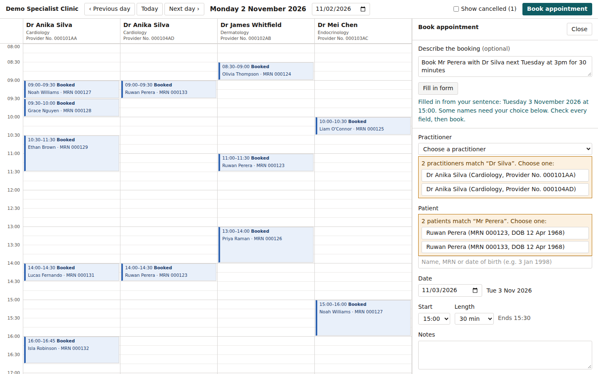
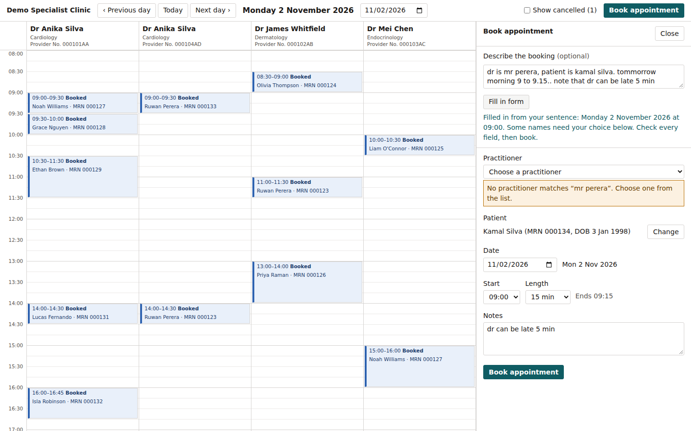

# Clinic Appointment Manager

An appointment book for a specialist clinic in Sydney. Front-desk staff see one day at a time, with one column per practitioner. They book, edit, cancel and record outcomes from a panel on the right. The backend stops double bookings for both the practitioner and the patient. An optional box lets staff type a booking in plain words, such as "Book Mr Perera with Dr Silva next Tuesday at 3pm", and fills in the form for them to check.



All names and records in the demo data are invented.

## How to run it

You need **Python 3.11 or newer** (tested on 3.11 and 3.14) and **Node.js 20.9 or newer** (tested on 24).

### With make (macOS, Linux, WSL)

```bash
make setup      # once: Python venv and packages, backend/.env, npm install
make backend    # terminal 1: API on http://localhost:8000
make frontend   # terminal 2: app on http://localhost:3000
```

If `python3` is not the version you want, run `make setup PYTHON=python3.12`.

### Without make

macOS and Linux:

```bash
cd backend
python3 -m venv .venv
.venv/bin/pip install -r requirements.txt
cp .env.example .env
.venv/bin/uvicorn app.main:app --reload --port 8000
```

Windows (PowerShell):

```powershell
cd backend
py -m venv .venv
.venv\Scripts\pip install -r requirements.txt
copy .env.example .env
.venv\Scripts\uvicorn app.main:app --reload --port 8000
```

Then, in a second terminal, on any system:

```bash
cd frontend
npm install
npm run dev
```

Open **http://localhost:3000**. Use `localhost`, not `127.0.0.1`, because the API only accepts requests from that address.

### Notes

- **Database:** a SQLite file is created at `backend/clinic.db` on first start and filled with demo data. The demo appointments are placed around today, so there is always something to see. To start again, run `make seed` (or `.venv/bin/python -m app.seed` in `backend/`).
- **Time zone:** the app always works in Sydney time, whatever time zone your computer is in.
- **Natural-language booking** needs a Google Gemini API key. Put it in `backend/.env` as `GEMINI_API_KEY=...` and restart the backend. Without a key the box is hidden and everything else works. The model is set by `GEMINI_MODEL` (default `gemini-3.5-flash-lite`).
- **Windows:** the Windows commands are written for PowerShell but have not been run on Windows.

## How to run the tests

| Tests | Command | Count |
|---|---|---|
| Backend (pytest) | `make test`, or `.venv/bin/pytest` in `backend/` (Windows: `.venv\Scripts\pytest`) | 195 |
| End to end (Playwright) | `make e2e`, or `npx playwright install chromium` then `npx playwright test` in `frontend/` | 3 |

The backend tests cover every booking rule, the API and the natural-language booking. They never call Gemini: the model is replaced by a fake with fixed answers.

The end-to-end tests book from a free slot, check that a clash shows its error under the right field, and cancel an appointment and find it again with "Show cancelled". They start their own backend on port 8001 with a fresh `backend/e2e.db`, and their own frontend on port 3001. Your development servers and `clinic.db` are not touched. The first run downloads a test browser. The backend must be set up first (`make setup`).

## Assumptions

- **Who uses it:** a receptionist at a single specialist clinic, on a desktop or laptop, often on the phone while booking.
- **Clinic hours:** Monday to Friday, 08:00 to 18:00 Sydney time. An appointment must start and finish within those hours.
- **Length:** 15 to 120 minutes. The panel offers 15, 30, 45, 60, 90 and 120.
- **Time zone:** Australia/Sydney, including daylight saving. Times are stored in UTC.
- **No double booking:** a practitioner, and a patient, can't have two appointments that overlap. Back-to-back appointments (one ends at 10:00, the next starts at 10:00) are allowed.
- **No bookings in the past.**
- **Statuses:** Booked, Completed, No-show and Cancelled.
  - Only a Booked appointment can be cancelled.
  - Completed and No-show can only be recorded once the appointment has started.
  - Cancelled is final; to undo it, book again.
  - A cancelled appointment frees its time slot.

## Key decisions

- **Identity:** names are never unique. The demo data has two "Dr Anika Silva" and two "Ruwan Perera" with the same date of birth, on purpose. The database id is the only identity. Patients have a unique MRN and practitioners a unique provider number, and people are always shown with them, e.g. "Ruwan Perera (MRN 000123, DOB 12 Apr 1968)". Dates are shown in words so they can't be read month-first.
- **Rules in one file:** every booking rule lives in [`backend/app/rules.py`](backend/app/rules.py) as a plain function that takes the current time as an argument, so each rule can be tested on its own. Create and edit both go through it. The frontend never repeats a rule: it asks the backend which actions are allowed for each appointment.
- **UTC storage:** times are stored in UTC and converted to and from Sydney time in one place, [`backend/app/timezones.py`](backend/app/timezones.py). The browser never converts time zones.
- **Simultaneous bookings:** each booking takes SQLite's write lock before checking for clashes. Two requests for the same slot at the same moment are handled one after the other, so only one succeeds. A test proves this, and it fails without the lock.
- **Records are kept:** cancelling changes the status and never deletes the appointment.
- **Natural-language booking is kept safe:**
  - Only the typed sentence, today's date and the time zone are sent to Gemini. No patient or practitioner records are sent. The request is sent with `store=false`, but on the free tier of the Gemini API Google's terms may still allow it to use the content, so a real clinic would need the paid tier and a data processing agreement.
  - The model's reply is treated as untrusted. It must pass strict validation, or the user sees a plain message.
  - It never saves anything. It only fills in the form, and the user checks it and presses "Book appointment". The normal rules run at that point.
  - It never guesses a person. The backend matches names itself. If a name matches several people, all of them are listed for the user to choose. If it matches nobody, the panel says so.
  
  Details, including the prompt, are in [docs/ai-booking.md](docs/ai-booking.md).

## Screenshots

Booking from a free slot, with a patient chosen from the search:



A clash, shown under the field it is about:



A typed sentence with ambiguous names. Nothing is picked until the user chooses (taken with the real Gemini API):



A messy sentence with spelling mistakes, where the "doctor" named is not a practitioner. The name is reported as not found instead of guessed. The patient, date, length and note are filled in (also real Gemini):



To retake the first three, run `make screenshots`.

## Known limitations

- No login or roles. Anyone who can open the app can do everything.
- No notifications or reminders.
- Practitioners come from the demo data only. There is no screen to add or edit them.
- No public holidays. The clinic is assumed open every weekday.
- "Next Tuesday" is read as the coming Tuesday. The panel shows the resolved date in words so staff can check it.
- Names typed into the natural-language box are sent to Google. The request uses `store=false`, but on the free tier Google's terms may still allow it to use the content. A real clinic would need the paid tier and a data processing agreement.
- The backend test run prints one warning from Starlette about `httpx`. It is harmless. `httpx` was kept on purpose instead of switching to the newer package.
- Under WSL with mirrored networking, `make e2e` waits about 4 minutes before the tests start. Playwright checks that ports 8001 and 3001 are free, and in that mode a closed port times out instead of refusing. The tests themselves take a few seconds.

## What I would do next

- Reminders by SMS or email, to cut no-shows.
- Staff login, roles and an audit log of who changed what.
- Practitioner working hours and leave, so the book only offers times when each practitioner works.